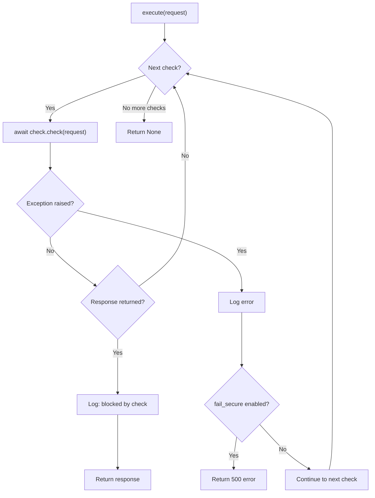

---

title: Security Checks Framework
description: SecurityCheck base class, SecurityCheckPipeline, and helper functions for building custom security checks in guard-core
keywords: security checks, pipeline, chain of responsibility, guard-core, adapter development
---

Security Checks Framework
=========================

The security checks framework is the backbone of guard-core's request processing. It implements a Chain of Responsibility pattern where each check runs in sequence, and the first check to return a non-`None` response terminates the pipeline.

SecurityCheck Base Class
------------------------

All security checks inherit from the abstract `SecurityCheck` class, which provides a consistent interface and shared utilities.

```python
from abc import ABC, abstractmethod
from guard_core.protocols.request_protocol import GuardRequest
from guard_core.protocols.response_protocol import GuardResponse


class SecurityCheck(ABC):
    requires: ClassVar[tuple[str, ...]] = ()

    def __init__(self, middleware: "GuardMiddlewareProtocol") -> None:
        self.middleware = middleware
        self.config = middleware.config
        self.logger = middleware.logger

    @classmethod
    def applies_to(
        cls, config: "SecurityConfig", route_configs: "Collection[RouteConfig] | None"
    ) -> bool:
        return True

    @abstractmethod
    async def check(self, request: GuardRequest) -> GuardResponse | None: ...

    @property
    @abstractmethod
    def check_name(self) -> str: ...

    async def send_event(
        self,
        event_type: str,
        request: GuardRequest,
        action_taken: str,
        reason: str,
        **kwargs,
    ) -> None: ...

    async def create_error_response(
        self, status_code: int, default_message: str
    ) -> GuardResponse: ...

    def is_passive_mode(self) -> bool: ...
```

### Constructor

The constructor receives a `GuardMiddlewareProtocol` instance and extracts `config` and `logger` from it. Adapter developers do not call this directly -- the middleware builds check instances during pipeline construction.

| Attribute    | Type                     | Source                |
|--------------|--------------------------|-----------------------|
| `middleware` | `GuardMiddlewareProtocol`| Passed to constructor |
| `config`     | `SecurityConfig`         | `middleware.config`   |
| `logger`     | `logging.Logger`         | `middleware.logger`   |

### Abstract Members

**`check(request) -> GuardResponse | None`**

The core method every check must implement. Returns `None` to pass the request to the next check, or a `GuardResponse` to block and respond immediately.

**`check_name -> str`**

A read-only property returning a unique string identifier for the check. Used in logging, pipeline management, and the `remove_check` method.

### Utility Methods

**`send_event(event_type, request, action_taken, reason, **kwargs)`**

Delegates to `middleware.event_bus.send_middleware_event()`. Adapter developers should use this for audit trail events rather than calling the event bus directly.

**`create_error_response(status_code, default_message)`**

Delegates to `middleware.create_error_response()`. The middleware implementation consults `SecurityConfig.custom_error_responses` for message overrides before creating the response via the adapter's `GuardResponseFactory`.

**`is_passive_mode()`**

Returns `self.config.passive_mode`. When passive mode is active, checks should log and emit events but not block requests.

### The `applies_to` Contract

Every check may override two class-level members that `build_default_pipeline` (`guard_core/core/checks/factory.py`) consults before a check is even instantiated:

**`applies_to(config, route_configs) -> bool`** (classmethod)

Declares whether the effective `SecurityConfig` and registered `route_configs` can ever make this check fire. The base implementation returns `True` unconditionally, so a new check that does not override it is always built and always runs -- writing a new check requires no changes here to stay correct, only an optional opt-in to build-time elimination. `route_configs` is `Collection[RouteConfig] | None`: `None` means the adapter could not enumerate its routes (unknown), and a known-empty tuple means no route carries a decorator.

**`requires: ClassVar[tuple[str, ...]]`**

Names the packaging extra(s) the check's handler needs, for example `("cloud",)` on `CloudProviderCheck`. Defaults to `()`.

**The rule when writing a predicate**: when in doubt, return `True`. Elimination is strictly an optimization, never a security decision -- a predicate that is uncertain whether the configuration can trigger the check must keep it, the same way every route-driven predicate in `guard_core.core.checks.helpers.route_config_applies` treats `route_configs is None` as "keep." A check that guards a resource writable from outside `SecurityConfig` entirely, the way `IpSecurityCheck` fronts a ban store that behavioral rules and other processes can write to, should not override `applies_to` at all and should rely on the base `True`. See [Build-Time Elimination](../architecture/pipeline.md#build-time-elimination) for the full mechanism and the per-check predicate table.

SecurityCheckPipeline
---------------------

The pipeline holds an ordered list of `SecurityCheck` instances and executes them sequentially.

```python
class SecurityCheckPipeline:
    def __init__(
        self, checks: list[SecurityCheck], muted_check_logs: set[str] | None = None
    ) -> None: ...
    async def execute(self, request: GuardRequest) -> GuardResponse | None: ...
    def add_check(self, check: SecurityCheck) -> None: ...
    def insert_check(self, index: int, check: SecurityCheck) -> None: ...
    def remove_check(self, check_name: str) -> bool: ...
    def get_check_names(self) -> list[str]: ...
```

### Execution Flow



### Error Handling

When a check raises an exception:

- The error is logged with `exc_info=True` for full traceback.
- `fail_secure` is a standard `SecurityConfig` field, defaulting to `True`; when it is `True`, the pipeline returns a `500` error response (fail-closed behavior).
- With `fail_secure=False`, the pipeline continues to the next check (fail-open behavior).

### Pipeline Manipulation

Adapters can modify the pipeline after construction:

| Method                          | Description                                              |
|---------------------------------|----------------------------------------------------------|
| `add_check(check)`             | Appends a check to the end of the pipeline               |
| `insert_check(index, check)`   | Inserts a check at a specific position                   |
| `remove_check(check_name)`     | Removes the first check matching the name; returns `bool`|
| `get_check_names()`            | Returns the ordered list of check name strings           |
| `len(pipeline)`                | Returns the number of checks                             |

!!! warning "Order Matters"
    Inserting checks at the wrong position can break assumptions. For example, `RouteConfigCheck` must run first because all subsequent checks read `request.state.route_config` and `request.state.client_ip`, which it populates.

Helper Functions
----------------

Helper functions are stateless utilities shared across check implementations.

### IP Access Helpers

**`is_ip_in_blacklist(client_ip, ip_addr, blacklist) -> bool`**

Checks whether `client_ip` appears in a list of blocked IPs or CIDR ranges.

**`is_ip_in_whitelist(client_ip, ip_addr, whitelist) -> bool | None`**

Returns `True` if allowed, `False` if explicitly not in the whitelist, or `None` if the whitelist is empty (no opinion).

**`check_country_access(client_ip, route_config, geo_ip_handler) -> bool | None`**

Evaluates country-based rules on a `RouteConfig`. Returns `False` to block, `True` to allow, `None` for no opinion.

**`check_route_ip_access(client_ip, route_config, middleware) -> bool | None`**

Combines blacklist, whitelist, and country checks for a route-level IP evaluation. Returns `False` on any deny condition.

### User Agent Helpers

**`check_user_agent_allowed(user_agent, route_config, config) -> bool`** (async)

Checks the user agent against both route-level `blocked_user_agents` and the global `config.blocked_user_agents` list. Uses case-insensitive regex matching. Each pattern is searched across the whole `User-Agent` header in windows of 512 characters that overlap by 256 (the length the ReDoS validator proves each pattern at), searched in place so `^` matches only at the real start and `$`, `\b` and lookaheads see the real end of the header; a match of up to 256 characters (lookahead included) gives exactly the verdict a search of the full header would. Cost grows linearly with the header length.

### Authentication Helpers

**`validate_auth_header(auth_header, auth_type) -> tuple[bool, str]`**

Validates that an `Authorization` header has the correct prefix for the specified type (`"bearer"`, `"basic"`, or custom). Returns `(True, "")` on success or `(False, reason)` on failure.

### Referrer Helpers

**`is_referrer_domain_allowed(referrer, allowed_domains) -> bool`**

Parses the referrer URL and checks the domain against a list. Supports subdomain matching (e.g., `sub.example.com` matches `example.com`).

### Penetration Detection Helpers

**`detect_penetration_patterns(request, route_config, config, should_bypass_check_fn) -> tuple[bool, str]`**

Orchestrates the penetration detection check. Respects decorator-level overrides and bypass configuration. Returns `(True, trigger_info)` when a threat is detected, or `(False, reason)` when skipped or clean.
